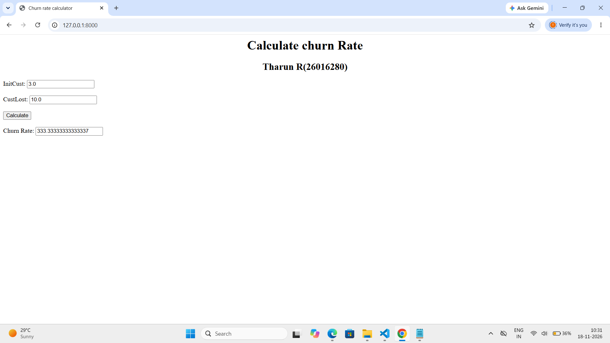
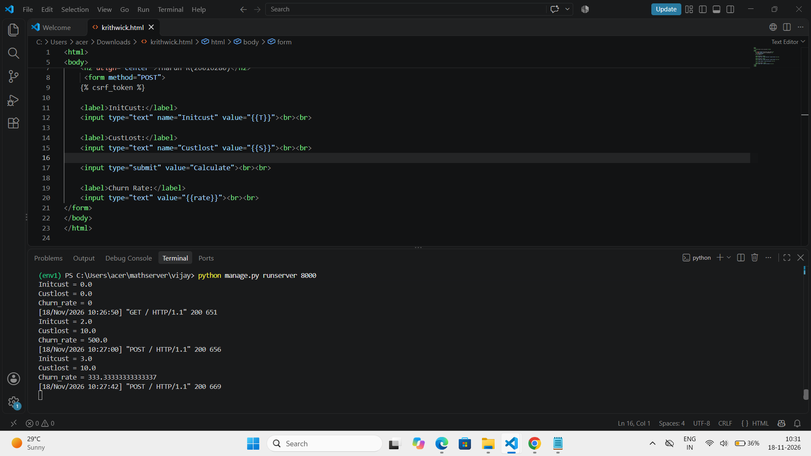

# Ex.03 Design a Website for Server Side Processing
## Date:17/11/2026

## AIM:
To create a web page to calculate Churn Rate using server-side scripts.

## FORMULA:
Churn Rate = (CustLost / InitCust) * 100
  InitCust --> Initial Customers Count
  CustLost --> Customers Lost Count

## DESIGN STEPS:

### Step 1:
Clone the repository from GitHub.

### Step 2:
Create Django Admin project.

### Step 3:
Create a New App under the Django Admin project.

### Step 4:
Create a HTML file to implement form based input and output.

### Step 5:
Create python programs for views and urls to perform server side processing.

### Step 6:
Receive input values from the form using request.POST.get().

### Step 7:
Calculate the Result using the given formula.

### Step 8:
Display the calculated result in the server console.

### Step 9:
Render the result to the HTML template.

### Step 10:
Publish the website in Localhost.

## PROGRAM:
'''
<html>
<head>
     <title>Churn rate calculator</title>
</head>
<body>
    <h1 align="center">Calculate churn Rate</h1>
    <h2 align="center">Tharun R(26016280)</h2>
     <form method="POST">
    

    <label>InitCust:</label>
    <input type="text" name="Initcust" value="{{T}}">  

    <label>CustLost:</label>
    <input type="text" name="Custlost" value="{{S}}">  

    <input type="submit" value="Calculate">  

    <label>Churn Rate:</label>
    <input type="text" value="{{rate}}">  
</form>
</body>
</html>
views.py
from django.shortcuts import render

def churn_rate(request):
    T = float(request.POST.get('Initcust', '0'))
    S = float(request.POST.get('Custlost', '0'))
    rate = (S / T) * 100 if request.method == 'POST' else 0
    print("Initcust =",T)
    print("Custlost =",S)
    print("Churn_rate =",rate)
    return render(request, 'sarapp/krithwick.html',{'T': T, 'S': S, 'rate': rate})
urls.py
from django.contrib import admin
from django.urls import path
from sarapp import views

urlpatterns = [path('', views.churn_rate, name='churn_rate'),]
'''

## OUTPUT - SERVER SIDE:

## OUTPUT - WEBPAGE:

## RESULT:
The the web page to calculate Churn Rate using server-side scripts is created successfully.
